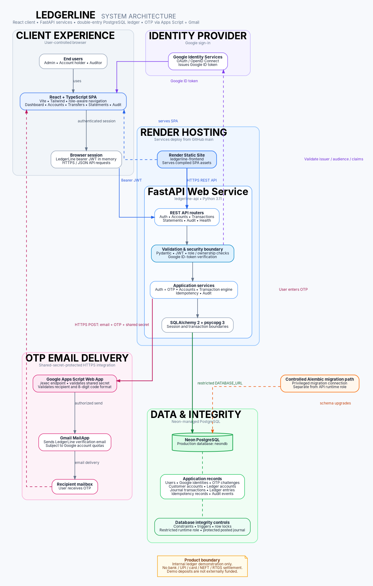

# LedgerLine — Project & Technical Documentation

**Documentation baseline:** 9 November 2026  
**Project category:** Full-stack internal financial-ledger demonstration  
**Previous confirmed Render source commit:** `e3121e2` (before the Apps Script OTP mailer integration)  
**Release status:** Final OTP mailer source changes have been implemented locally and focused tests were reported passing; the final Git commit, push, and Render deployment must be confirmed before submission.

> **Product boundary:** LedgerLine records money movement inside its own demonstration ledger. It is not connected to a bank, UPI network, card processor, NEFT/RTGS rail, or external settlement provider. Demo deposits are synthetic internal ledger operations and are not evidence of real funds.

## 1. Executive summary

LedgerLine is a full-stack financial-ledger demonstration application. It combines a role-aware React browser client, a Python/FastAPI application service, and PostgreSQL persistence. The backend owns authentication, authorization, account operations, transaction posting, idempotency, and audit behaviour. The browser is a presentation client and is not a security boundary.

The application supports password authentication and Google Identity Services sign-in. Both authentication paths require email one-time-password (OTP) verification before a LedgerLine JWT is issued. Google identities are explicitly linked to an existing same-email account only after a confirmation step and OTP verification. OTP email delivery is being moved from Resend's restricted test sender to a Google Apps Script web app that sends mail through Gmail `MailApp`.

The financial domain uses integer paise, balanced journal postings, idempotency controls, PostgreSQL transactions and row locks, and protected posted journal history. Production PostgreSQL is hosted on Neon; the frontend and backend are hosted as separate Render services.

## 2. Deployment topology and release status

| Component | Deployment / service | Known status |
|---|---|---|
| Frontend | Render Static Site: `https://ledgerline-frontend-bmtt.onrender.com` | Previously confirmed Live on `e3121e2`; re-check after final push |
| Backend API | Render Web Service: `https://ledgerline-api-9dld.onrender.com` | Previously confirmed Live on `e3121e2`; re-check after final push |
| Health endpoint | `https://ledgerline-api-9dld.onrender.com/health` | Previously returned `{"status":"ok"}` / HTTP 200 |
| Database | Neon PostgreSQL, project `ledgerline`, database `neondb` | Production migration confirmed at Alembic `20261108_0007 (head)` |
| Source control | Private GitHub repository, branch `main` | Final mailer commit hash must be recorded after push |
| OTP email transport | Google Apps Script Web App + Gmail `MailApp` | Test mail delivered; integration code and 37 focused tests reported by Copilot; production delivery test must be repeated after deployment |

Render free instances may spin down after inactivity; an initial request can take longer while the service wakes.

### 2.1 Release acceptance status

**Previously verified in the deployed application:**

- Password sign-in: OTP email received, OTP accepted, dashboard reached.
- Google sign-in for a Google email matching an existing password account: explicit account-link confirmation displayed, confirmation completed, OTP received, OTP accepted, dashboard reached.
- Internal transfer flow was live-tested earlier, including balance update.
- API health endpoint returned HTTP 200.

**Verified during the Apps Script setup:**

- The Apps Script `testMailer` function successfully sent a test email to the script owner's account.
- The Apps Script web app was deployed and its `/exec` URL was provided to the backend integration.
- GitHub Copilot reported 37 focused OTP, authentication, and health tests passing after the Apps Script backend change.

**Still required before submission:**

- Confirm the Apps Script integration changes are committed and pushed to `main`.
- Confirm Render backend deployment is Live on that new commit.
- Confirm Render contains `OTP_MAILER_URL` and `OTP_MAILER_SECRET` with the matching values, while retaining `OTP_HMAC_SECRET`.
- Test registration using an email address different from the Apps Script owner's email; confirm delivery, OTP verification, and dashboard access.
- Re-run the full backend test suite after the integration change, if time permits, and record the actual result. The 75-pass full-suite result predates the Apps Script integration.

Do not mark these pending items as complete until the corresponding live checks have been performed.

## 3. Functional scope

### 3.1 Authentication and identity

- Password registration and sign-in.
- Argon2 password hashing.
- Signed, expiring LedgerLine bearer JWTs.
- Google Identity Services sign-in with backend-side Google ID-token verification (audience and identity claims).
- Email OTP challenge for password and Google sign-in paths.
- Explicit confirmation before linking a Google identity to an existing same-email account; no silent account merge.
- Disabled-user checks and role-aware access for `ADMIN`, `ACCOUNT_HOLDER`, and `AUDITOR`.

### 3.2 OTP controls

The implementation described in the code and test summary includes:

- Eight-digit OTP generated using a cryptographically secure random source.
- HMAC-SHA256 digest stored for challenge verification rather than storing the plaintext OTP.
- Challenge expiry of five minutes.
- Single-use challenge consumption.
- Maximum of five verification attempts.
- Sixty-second resend cooldown.
- Maximum of five sends in a one-hour send window.
- OTP is verified by the backend before issuing the LedgerLine JWT.

### 3.3 OTP email delivery architecture

The current integration target is a Google Apps Script Web App. The backend sends an HTTPS JSON POST containing `secret`, `email`, and `code` to the configured `OTP_MAILER_URL`. The Apps Script endpoint compares the supplied secret with the Script Property `LEDGERLINE_MAILER_SECRET`, validates the email and eight-digit code format, checks the remaining daily mail quota, and calls `MailApp.sendEmail`. The endpoint returns JSON with `ok: true` on success; the backend follows redirects, checks the final HTTP response, parses the JSON, and treats any non-success response as an OTP delivery failure.

The shared secret must be identical in the Apps Script Script Property and Render's `OTP_MAILER_SECRET` environment variable. The backend environment variable `OTP_MAILER_URL` must contain the deployed Apps Script `/exec` URL. Keep `OTP_HMAC_SECRET` separately configured; it is used to protect stored OTP digests and is not the mailer authentication secret.

Resend was originally used for OTP delivery. A live Resend request using `onboarding@resend.dev` returned HTTP 403 because Resend's testing domain only permits the Resend account's own recipient address. The Apps Script/Gmail mailer is the chosen alternative for the demo. The old `RESEND_*` variables may still exist in Render but are not used by the new code path according to the Copilot implementation summary; remove them only after successful live verification and confirmation that no remaining code references them.

### 3.4 Financial accounts and ledger operations

- Financial account management with server-side ownership and role checks.
- Internal deposit, withdrawal, and transfer operations.
- Double-entry journal transactions with ledger entries and balanced posting rules.
- Monetary amounts represented in integer paise, not binary floating-point values.
- Idempotency records to prevent duplicate posting on retried requests.
- Compensating reversal operations rather than editing/deleting posted journal history.
- Account statements / transaction history and audit views.

**Important:** Demo deposits are internally balanced against a clearing ledger account but are not externally funded. LedgerLine does not move real funds.

### 3.5 Audit and operational visibility

- Audit events capture significant authentication, account, and transaction actions.
- Sensitive credentials, OTP values, shared mailer secrets, and bearer tokens must not be written to logs or audit details.
- Health endpoint for basic service status.

## 4. System architecture

The full system diagram is maintained in three formats:

- `docs/architecture/system-architecture.png` — image for README, reports, and presentations.
- `docs/architecture/system-architecture.svg` — scalable vector diagram.
- `docs/architecture/system-architecture.dot` — editable Graphviz source.

The OTP-specific flow is documented separately:

- `docs/architecture/authentication-otp-flow.png`
- `docs/architecture/authentication-otp-flow.svg`
- `docs/architecture/authentication-otp-flow.dot`

### 4.1 Logical layers

| Layer | Technologies | Responsibility |
|---|---|---|
| Browser client | React, TypeScript, Vite, Tailwind CSS | Screens, forms, role-aware navigation, dashboard, account and transaction views, API calls |
| Hosting | Render | Hosts the static frontend and FastAPI web service |
| API / application | Python, FastAPI, Pydantic, SQLAlchemy | Request validation, authentication, authorization, application services and transaction orchestration |
| Persistence | Neon PostgreSQL, Alembic | Durable user/account data, OTP challenges, journals, idempotency, audit events and schema migrations |
| Identity provider | Google Identity Services / Google OAuth | Browser sign-in and Google ID token issuance |
| OTP mail transport | Google Apps Script Web App, Gmail `MailApp` | Shared-secret-protected HTTPS email request and OTP email delivery |

### 4.2 Main request flow

1. A user interacts with the React single-page application served by Render.
2. The frontend calls the FastAPI service over HTTPS.
3. FastAPI validates request schemas and independently enforces authentication, role, and resource-ownership policies.
4. Application services apply business rules and use SQLAlchemy/psycopg to access Neon PostgreSQL.
5. The database commits balance updates, journal postings, idempotency outcomes, and relevant audit events within the appropriate transaction boundary.
6. The API returns structured responses; authenticated requests use the LedgerLine bearer token.

### 4.3 Authentication and OTP flow

**Password path:** browser submits credentials → API verifies password → API creates an OTP challenge and persists its HMAC digest → backend calls the Apps Script `/exec` endpoint over HTTPS → Apps Script validates the shared secret and sends through Gmail `MailApp` → user receives OTP → browser submits challenge ID and code → API verifies and consumes the challenge → API issues LedgerLine JWT.

**Google path:** browser obtains a Google ID token through Google Identity Services → backend validates the ID token against `GOOGLE_CLIENT_ID` and required claims → backend resolves the Google subject or requests explicit linking if the email belongs to an existing account → OTP challenge is created and delivered using the same Apps Script/Gmail path → user verifies the OTP → API completes identity linking when applicable and issues LedgerLine JWT.

### 4.4 Data model / ERD

The database ERD remains a separate architecture artifact at `docs/architecture/erd.mmd.png`. The mailer change is an external delivery-provider integration and does not, by itself, add or alter database entities; therefore the ERD should remain unchanged unless the actual migration/model files introduce schema changes.

The key database concepts are:

- Users and provider identities (`user_identities`).
- OTP challenges (`email_otp_challenges`), including challenge digest, expiry, attempt count, send window, consumed state, and pending Google-link information.
- Customer-facing accounts and ledger accounts.
- Journal transactions and ledger entries.
- Idempotency records.
- Audit events.

PostgreSQL constraints, triggers, row locking, and role privileges contribute to the data-integrity boundary.

### 4.5 Database access and migrations

- Running API uses a restricted, non-superuser runtime database role (`ledgerline_app`).
- Alembic migrations use a separate privileged migration connection.
- Do not add a privileged migration URL to the long-running API service environment.
- Production Neon migration was confirmed at `20261108_0007 (head)`.
- Local Docker Compose PostgreSQL was configured to bind to loopback (`127.0.0.1`).

## 5. Technology stack

| Area | Technology |
|---|---|
| Frontend | React, TypeScript, Vite, Tailwind CSS |
| Backend | Python 3.11.9, FastAPI, Pydantic |
| ORM / database access | SQLAlchemy 2, psycopg 3 |
| Database | PostgreSQL (Neon hosted; Docker Compose for local development) |
| Schema migrations | Alembic |
| Password security | Argon2 |
| API authentication | JWT (HS256 as configured) |
| Google identity | Google Identity Services / Google OAuth ID-token validation |
| OTP digest | HMAC-SHA256 using `OTP_HMAC_SECRET` |
| OTP mail delivery | Google Apps Script Web App + Gmail `MailApp` |
| Hosting | Render (frontend static site + backend web service) |
| Backend tests | pytest |
| Frontend checks | TypeScript typecheck, lint, tests, Vite production build |

## 6. Runtime configuration reference

Names only. Never commit actual values.

### 6.1 Backend (`ledgerline-api`)

| Variable | Purpose |
|---|---|
| `APP_ENV` | Runtime environment |
| `APP_NAME` | Service display name |
| `CORS_ALLOWED_ORIGINS` | Allowed browser origins |
| `DATABASE_URL` | Restricted runtime PostgreSQL connection |
| `GOOGLE_CLIENT_ID` | Expected Google ID-token audience |
| `JWT_ACCESS_TOKEN_MINUTES` | LedgerLine access-token lifetime |
| `JWT_SECRET_KEY` | JWT signing secret |
| `LOG_LEVEL` | Backend logging level |
| `OTP_HMAC_SECRET` | HMAC key used for OTP challenge digests |
| `OTP_MAILER_URL` | Deployed Apps Script Web App `/exec` endpoint |
| `OTP_MAILER_SECRET` | Shared secret matching Script Property `LEDGERLINE_MAILER_SECRET` |

`MIGRATION_DATABASE_URL` is privileged and migration-only; do not put it in the normal API service. `RESEND_API_KEY` and `RESEND_FROM_EMAIL` are legacy settings from the previous mail transport and are no longer used by the Apps Script mailer integration according to the implementation summary. Verify there are no remaining code references before removing them.

### 6.2 Frontend (`ledgerline-frontend`)

| Variable | Purpose |
|---|---|
| `VITE_API_BASE_URL` | Public API base URL |
| `VITE_GOOGLE_CLIENT_ID` | Google Identity Services browser client ID |

All `VITE_*` values are exposed to the browser bundle. Never put API keys, passwords, HMAC secrets, mailer secrets, database passwords, or Google client secrets in frontend variables.

### 6.3 Apps Script deployment settings

- Deployment type: Web app.
- Execute as: the deploying Google account (owner).
- Access: Anyone, with the shared secret checked in code.
- Script Property key: `LEDGERLINE_MAILER_SECRET`.
- Backend key: `OTP_MAILER_SECRET` (same value).
- Backend URL: `OTP_MAILER_URL` (deployed `/exec` URL).

The web app URL is not a substitute for authorization; the shared secret is required. Do not publish the secret or log the request body. Apps Script/Gmail quotas and policies apply to delivery volume.

## 7. Security controls and limitations

### Implemented controls described by code and prior verification

- Argon2 password hashes; signed, expiring JWTs; Google ID-token validation; email OTP gating.
- Explicit account-link confirmation; disabled-user checks.
- Backend role and object ownership checks.
- Integer-paise amounts, database transactions, account locking, balanced journal posting, idempotency, constraints and triggers.
- Protected posted journal history with compensating reversals.
- Restricted runtime database role and separate migration credentials.
- OTP HMAC digest, expiry, attempt cap, resend cooldown and send-window cap.
- Apps Script mailer shared-secret check and request validation.

### Limitations / residual risks

- Ledger balances are internal demo balances, not bank balances or externally funded money.
- No bank, UPI, card, NEFT/RTGS, payout or settlement integration exists.
- Gmail Apps Script delivery is appropriate for a low-volume demonstration; it is subject to Google account quotas and is not a substitute for a production transactional email provider with a verified sender domain, delivery analytics, bounce handling and operational monitoring.
- Apps Script web app is internet reachable when deployed with public access; the shared secret protects the mail operation. Rotate it immediately if exposed.
- Frontend bearer token is memory-held and accessible to same-origin JavaScript; this is not an HttpOnly-cookie design.
- Database superusers/host administrators can bypass database-level application protections.
- External firewall policy, backups/restore drills, independent penetration testing and formal regulatory compliance were not established by the verification described here.
- No PCI DSS, banking-regulatory or other compliance certification is claimed.

## 8. Verification record

Recorded results from the work session:

| Check | Result | Timing / qualification |
|---|---|---|
| Backend full suite | 75 passed, one non-blocking Starlette deprecation warning | Before Apps Script integration |
| Backend focused suite | 37 passed | Reported by Copilot after Apps Script mailer integration; rerun locally before final release if possible |
| Backend earlier focused suite | 66 passed, one warning | Before latest Apps Script integration |
| Frontend typecheck | Passed | Before latest backend-only mailer integration |
| Frontend production build | Passed; 2,608 modules transformed in recorded run | Before latest backend-only mailer integration |
| Production Alembic current | `20261108_0007 (head)` | Confirmed on 8 November 2026 |
| Live password OTP login | OTP received; verified; dashboard reached | Live manual smoke test |
| Live Google account linking | Existing-account confirmation; OTP received; verified; dashboard reached | Live manual smoke test |
| Apps Script test mail | Delivered to script owner's account | Manual Apps Script test function |
| New recipient registration | Not yet confirmed after Apps Script integration | Must be tested on deployed new code |

These results are historical verification evidence, not a guarantee about a later deployment. Re-run tests after source changes and confirm the final Render commit before submission.

## 9. Final release checklist

- [ ] Review `git status --short`; stage only intended source, test, documentation and architecture files.
- [ ] Confirm no `.env`, `.env.runtime`, private keys, Google client secret, database password, JWT secret, OTP HMAC secret, or mailer secret is staged.
- [ ] Run the full backend test suite after the Apps Script integration (the reported 37-test focused run is not a substitute for a full run).
- [ ] Run frontend typecheck/build if frontend files changed.
- [ ] Commit and push the Apps Script mailer integration and documentation to `main`.
- [ ] Confirm Render backend is Live on the new commit; frontend remains Live.
- [ ] Confirm `OTP_MAILER_URL`, `OTP_MAILER_SECRET`, and `OTP_HMAC_SECRET` are set on Render backend.
- [ ] Test a fresh registration to an email different from the Apps Script owner's address; verify email arrives, OTP is accepted, and dashboard opens.
- [ ] Retest password sign-in and Google account linking after deployment.
- [ ] Verify health endpoint and core account/transfer/statement/audit screens.
- [ ] Capture clear screenshots for the hiring submission.
- [ ] Record final source commit hash and live URLs in the submission.

## 10. Repository documentation map

- `README.md` — project entry point, setup and quick links.
- `THREATS.md` — threat model and security review.
- `docs/PROJECT_DOCUMENTATION.md` — full project and technical documentation.
- `docs/architecture/system-architecture.*` — full-stack system design (PNG/SVG/DOT).
- `docs/architecture/authentication-otp-flow.*` — password/Google OTP and email delivery flow (PNG/SVG/DOT).
- `docs/architecture/erd.mmd.png` — database entity-relationship diagram.

Update the Markdown and editable `.dot` sources together whenever architecture changes. PNG/SVG are generated viewing artifacts; Graphviz DOT is the editable source of truth for the architecture images.
