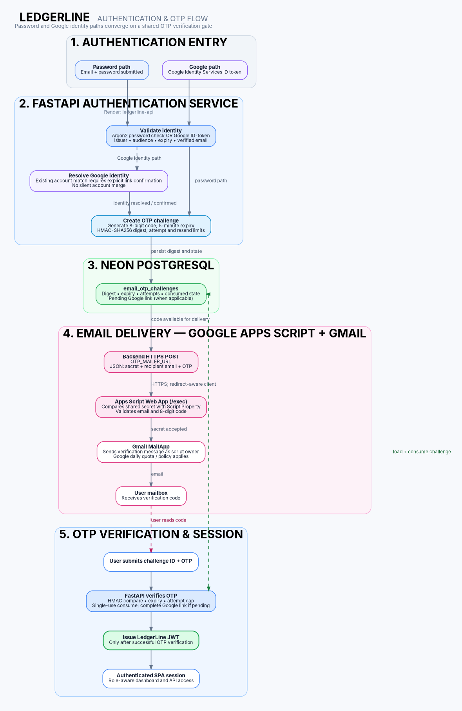

# LedgerLine - Project and Technical Documentation

**Documentation baseline:** 9 November 2026
**Project category:** Full-stack internal financial-ledger demonstration
**Repository:** [rohitsai4429/ledgerline](https://github.com/rohitsai4429/ledgerline) (private; reviewer access must be granted by the owner)
**Deployment:** Render Free frontend and backend; production Neon PostgreSQL
**Known verification:** Backend full suite 75 passed before the Apps Script mailer integration; focused OTP/authentication/health suite 37 passed after integration. Live password login and Google sign-in/account linking succeeded. Fresh registration to a different mail recipient remains unverified after the mailer change.

> **Product boundary:** LedgerLine records transactions in an internal demonstration ledger. It is not connected to a bank, UPI network, card processor, NEFT/RTGS rail, or external settlement provider. Demonstration deposits are not externally funded money.

## 1. Executive summary

LedgerLine is a React browser client, Python/FastAPI modular monolith, and
PostgreSQL application for demonstrating account management and auditable
double-entry ledger operations. Authentication supports email/password and
Google Identity Services. Both paths require an email OTP before the backend
issues a LedgerLine JWT. The production web services are on Render Free and
the production database is on Neon PostgreSQL, as confirmed by the project
owner.

## 2. Problem statement

The project demonstrates how internal account balances and financial records
can be changed through authenticated operations while maintaining balanced
journals, preventing duplicate requests, and preserving an audit trail. It
does not execute payments or settle funds outside its own database.

## 3. Project objectives

- Enforce account ownership and role-aware access in the backend.
- Store monetary values as integer paise and limit the application to INR.
- Post every financial operation as balanced double-entry records.
- Protect balances from overdraft and concurrent overspend.
- Make retried requests idempotent and preserve posted history.
- Provide account history, statements, administrative controls, and audit
  visibility.
- Require OTP verification before granting a bearer-token session.

## 4. Functional requirements

The application implements public registration and login, Google sign-in,
OTP challenge/resend/verification, account creation and status management,
recipient lookup, internal deposits/withdrawals/transfers, administrator
reversals, transaction history, statements, and role-limited audit history.
See the [API Reference](API_REFERENCE.md) for routes and access requirements.

## 5. Non-functional requirements

The implementation emphasizes request validation, transaction atomicity,
database-enforced financial constraints, bounded pagination, role and
ownership checks, structured logs, retry safety, and separation of runtime
and migration database privileges. This is not a formal availability,
performance, compliance, or penetration-test certification.

## 6. Scope and limitations

The ledger is INR-only and uses synthetic internal clearing accounts. There
is no real bank, UPI, card, payout, or payment-provider settlement; no
multi-currency or FX; no joint-account workflow; and no external funding
authorization. Render Free services can sleep after inactivity. Gmail
Apps Script delivery is quota-dependent and does not provide production
transactional-email bounce analytics. Other limitations are recorded in
[Section 30](#30-known-limitations).

## 7. Complete technology stack

The current dependency and evidence-based technology inventory is maintained
in [TECHNOLOGY_STACK.md](TECHNOLOGY_STACK.md). Active application choices
include Python 3.11, FastAPI, Pydantic, SQLAlchemy, Alembic, Psycopg 3,
PostgreSQL 17, React, TypeScript, Vite, Tailwind CSS, TanStack Query, Google
Identity Services, PyJWT, Argon2, HTTPX, and Google Apps Script/Gmail for OTP
email. Resend is historical, not the current runtime provider.

## 8. System architecture

The browser sends HTTPS JSON requests to FastAPI on Render. FastAPI performs
validation, authentication, authorization, service orchestration, and
database access through SQLAlchemy. The API uses a restricted runtime role
to connect to Neon PostgreSQL over TLS. Google Identity Services supplies
Google ID-token credentials; the backend calls the configured Apps Script
Web App for OTP mail.

[Current GitHub-rendered system architecture diagram](architecture/system-architecture.md)

The current system diagram uses editable
[system-architecture.mmd](architecture/system-architecture.mmd). The editable
Graphviz sources are [system-architecture.dot](architecture/system-architecture.dot)
and [authentication-otp-flow.dot](architecture/authentication-otp-flow.dot).
The [deployment architecture](architecture/deployment-architecture.md) and
[transaction workflow](architecture/transaction-flow.md) use GitHub-rendered
Mermaid because Graphviz is not installed in the current authoring environment.

## 9. Frontend architecture

The Vite SPA is organized into `src/api`, `src/auth`, `src/components`,
`src/hooks`, `src/pages`, `src/types`, and `src/utils`. React Router defines
lazy-loaded pages and role-aware route guards. TanStack Query manages API
server state. The API client attaches the in-memory bearer token and converts
integer-paise JSON values safely before UI formatting.

React Hook Form and Zod provide client-side validation; server schemas remain
authoritative. Transaction submission stores a pending idempotency key and
exact request payload in tab-scoped `sessionStorage` to retry an ambiguous
network result without creating a new operation key. This retry state is not
the authentication token store.

## 10. Backend architecture

The backend is a modular monolith:

- `api/routes/`: health, authentication, account, and transaction endpoints.
- `api/dependencies.py`: request database sessions, bearer-user resolution,
  and role checks.
- `schemas/`: Pydantic request/response contracts and bounds.
- `models/`: SQLAlchemy user, identity, OTP, account, ledger, journal,
  idempotency, and audit models.
- `repositories/`: persistence queries.
- `services/`: business operations, auth/Google/OTP, account, transaction,
  and audit logic.
- `core/`: cached Pydantic settings, Argon2/JWT helpers, JSON logging.
- `database/`: engine, session factory, and request-scoped sessions.

`main.py` configures CORS with explicit origins, no credentialed cookies, and
the methods/headers needed by the SPA. Routes map known domain failures to
HTTP responses; unexpected failures do not return success-shaped data.

## 11. API design and endpoint catalogue

The API is versioned under `/api/v1`, uses JSON, and returns FastAPI/Pydantic
validation errors. Financial mutation requests require an `Idempotency-Key`.
The full route, role, request, response, and common-error catalogue is in
[API_REFERENCE.md](API_REFERENCE.md).

## 12. Authentication architecture

Password registration normalizes email, hashes the password with Argon2,
and creates an OTP challenge. Login verifies credentials and user status
before issuing a challenge. The token response is not returned by either
entry route. Only successful OTP verification produces the signed, expiring
JWT.

## 13. Google OAuth architecture

The SPA loads the Google Identity Services JavaScript client, renders its
credential button, and submits the returned ID token to FastAPI. This is a
credential flow, not a traditional redirect/callback flow. `google-auth`
verifies the token audience, signature, expiration, and claims; the backend
also checks issuer, subject, email shape, and verified-email status.

Google subjects are stored in `user_identities`. A subject already linked to
an active user can start OTP sign-in. If the Google email matches an existing
unlinked account, the client must explicitly confirm linking, then complete
email OTP verification before the mapping is created. The Google Web Client
ID is public browser configuration; it is not a secret. The exact Google
Cloud project, consent-screen state, and authorized-origin list were not
independently inspected in this documentation audit.

## 14. OTP email architecture

FastAPI generates an eight-digit code, stores only its HMAC-SHA256 digest in
the persistent challenge record, and sends the plaintext code through the
Apps Script mailer. The challenge expires in five minutes, permits at most
five verification attempts, allows a 60-second resend cooldown and five
sends in its one-hour window, and is consumed once. Successful verification
is audited; replay is rejected.

The Apps Script Web App receives a JSON POST with `secret`, `email`, and
`code`; the backend follows redirects, checks HTTP status, and requires final
JSON `{"ok": true}`. Configure `OTP_MAILER_URL`, `OTP_MAILER_SECRET`, and
`OTP_HMAC_SECRET` on the backend. The script's shared-secret property is
named `LEDGERLINE_MAILER_SECRET`; it must match `OTP_MAILER_SECRET`.
See [Environment Configuration](ENVIRONMENT_CONFIGURATION.md).
The Apps Script implementation is external to this repository; its source,
deployment settings, and stored property were not independently reviewed.

## 15. Database architecture

The ORM models map to PostgreSQL UUID-keyed records. The repository migration
head is `20261108_0007`; `alembic heads` reported this as the sole head during
the audit. Production Neon's currently applied version was not queried in
this documentation pass; an earlier project record reported `0007`.
Production connections are documented as TLS-enabled, with a pooled runtime
URL and a separate direct privileged migration URL.

## 16. Entity relationships

Users own customer accounts and customer ledger accounts. Each customer
account links to one ledger account. System deposit/withdrawal clearing
ledger accounts have no customer owner. Journal transactions reference
source/destination accounts where applicable; their ledger entries reference
the journal and ledger account. Users may have a Google identity and one
persistent OTP challenge. Idempotency records scope keys to users and point
to successful journal records. Audit events identify an actor when known and
may associate with a journal.

The Apps Script integration adds no database entity. This documentation pass
does not alter the existing ERD image.

## 17. Financial ledger design

Money uses positive integer paise; currency checks constrain accounts,
journals, and entries to INR. The model distinguishes customer accounts
from system clearing and accounting ledger accounts. Each journal is
represented by debit/credit ledger entries. Account balances are materialized
values checked against ledger totals by PostgreSQL consistency triggers.

## 18. Transaction lifecycle

1. Authenticate the bearer token; validate role and account ownership.
2. Validate the amount and required idempotency key.
3. Begin a database transaction, acquire the user/key advisory transaction
   lock, and check any existing idempotency record.
4. Lock affected account rows in deterministic UUID order.
5. Check account status, ownership, balance, and amount limits.
6. Update balances and create journal and debit/credit entries.
7. Record idempotency outcome and audit event.
8. Let database constraints/triggers validate before atomic commit.

Rejected business operations are recorded with their rejection outcome where
the service contract permits; unexpected database failures roll back
financial writes. The
[transaction workflow diagram](architecture/transaction-flow.md) shows
the normal and reversal paths.

## 19. Double-entry accounting rules

For each posted operation, debit and credit entries have positive amounts
and balance in INR. Database validation enforces valid journal shape and
consistency with linked accounts and materialized balances. Deposit and
withdrawal entries use internal clearing accounts. Those entries are
accounting demonstrations, not settlement with an external institution.

## 20. Concurrency and idempotency

PostgreSQL row locks serialize conflicting changes to account balances.
Advisory transaction locks serialize identical actor/idempotency-key requests.
The backend hashes canonical request payloads: retrying the same key and
payload returns the saved result, while reusing a key with changed content
is rejected. Unique constraints provide a database backstop. Reversals are
linked and idempotent; original posted data is not rewritten.

## 21. Authorization and user roles

| Role | Access |
|---|---|
| `ACCOUNT_HOLDER` | Create accounts, access owned accounts, use internal deposit/withdrawal/transfer, read owned transaction and statement data |
| `ADMIN` | Read all accounts/transactions, manage account status, reverse eligible transactions, read audit history |
| `AUDITOR` | Read system account/transaction/audit data; no financial or account-status mutations |

Public registration creates only `ACCOUNT_HOLDER`. Authorization is enforced
in FastAPI services/routes; frontend route guards are only presentation.

## 22. Audit logging

Application audit records cover authentication outcomes, account creation
and status changes, authorization denials, and financial successes/rejections.
Anonymous events may have a null actor. Details are categorical and omit
passwords, OTPs, tokens, and shared mailer secrets. JSON application logs
include timestamp, level, logger, message, and exception text when present;
operators must avoid logging request bodies or credentials.

## 23. Security controls and threat model

Controls include Argon2 password hashing, signed expiring JWTs with required
claims, Google ID-token verification, OTP HMAC digests/limits, explicit
account linking, backend role/ownership checks, request validation, CORS
allowlisting, idempotency, PostgreSQL integrity constraints, protected
posted records, and a restricted runtime database role. They do not make
the application tamper-proof. See [THREATS.md](../THREATS.md) for test
evidence and residual risk.

## 24. Development setup

The root [README](../README.md) contains Windows/PowerShell setup, backend
venv and Docker Compose PostgreSQL instructions, frontend npm setup, and
commands. Install declared dependencies only from `backend/requirements.txt`
and `frontend/package-lock.json`. The local PostgreSQL container publishes
on loopback port 5433.

## 25. Environment configuration

See [ENVIRONMENT_CONFIGURATION.md](ENVIRONMENT_CONFIGURATION.md) for
separate Render frontend/backend, local frontend/backend, Apps Script, and
migration-only variables. `.env` and `.env.runtime` are ignored. Never place
private values in `VITE_*` settings or commit credentials.

## 26. Deployment architecture

| Component | Deployment |
|---|---|
| Frontend | [Render Static Site](https://ledgerline-frontend-bmtt.onrender.com) |
| Backend | [Render Web Service](https://ledgerline-api-9dld.onrender.com) |
| Health | [Backend `/health`](https://ledgerline-api-9dld.onrender.com/health) |
| Database | Production Neon PostgreSQL |
| OTP email | Google Apps Script Web App + Gmail MailApp |

The Render manifest configures the static publish path, SPA fallback, Python
runtime/start command, health route, API origin, and frontend API base URL.
Secrets and some Google/OTP variables require manual Dashboard configuration.
The actual Render auto-deploy trigger and currently running backend commit
were not independently verified in this audit.

The [deployment architecture diagram](architecture/deployment-architecture.md)
embeds the editable [Mermaid source](architecture/deployment-architecture.mmd)
in GitHub-rendered Markdown. No new PNG/SVG was generated because Graphviz
was unavailable.

## 27. Database migrations

The linear migration chain is:

1. `20261107_0001` — users.
2. `20261107_0002` — accounts and customer ledger linkage.
3. `20261107_0003` — transaction journals, ledger entries, idempotency,
   audit, clearing accounts, and integrity mechanisms.
4. `20261107_0004` — nullable audit actor.
5. `20261107_0005` — runtime privilege hardening.
6. `20261108_0006` — Google identities and OTP challenges.
7. `20261108_0007` — correct legacy email-verification state.

Alembic requires the privileged `MIGRATION_DATABASE_URL`, separate from
runtime settings. Production migration status should be checked with a
trusted direct connection before any future release; do not run migrations
in the Render web process.

## 28. Testing strategy and test results

Backend tests use Pytest, FastAPI's HTTPX-backed test client, isolated SQLite
for some auth/unit cases, and PostgreSQL for account, migration, transaction,
concurrency, and least-privilege integration checks. Frontend uses Vitest,
Testing Library, Playwright, Oxlint, TypeScript, and Vite.

| Result | Scope and time |
|---|---|
| 75 backend tests passed | Full backend suite before the Apps Script mailer integration |
| 37 tests passed | Focused OTP/authentication/health suite after the mailer integration, per latest report |
| 16 frontend tests across 8 files passed | Earlier frontend verification recorded in `PROMPTS.md` |
| Typecheck, lint, production build passed | Earlier frontend verification; not a fresh result for this documentation pass |
| One Playwright journey passed | Previously reported E2E journey; historical, not rerun here |

These are historical results, not claims that all suites were rerun as part
of this documentation work. Live password login/OTP and Google
sign-in/account linking succeeded. Fresh registration to a different email
after mailer integration remains to be verified.

## 29. Production URLs

- Frontend: [ledgerline-frontend-bmtt.onrender.com](https://ledgerline-frontend-bmtt.onrender.com/)
- Backend: [ledgerline-api-9dld.onrender.com](https://ledgerline-api-9dld.onrender.com/)
- Health: [backend `/health`](https://ledgerline-api-9dld.onrender.com/health)
- Repository: [rohitsai4429/ledgerline](https://github.com/rohitsai4429/ledgerline) (private; arrange reviewer access with the owner)

## 30. Known limitations

- No real bank, UPI, card, payout, or payment settlement; no external funding.
- INR only; no multi-currency or foreign-exchange handling.
- Fresh non-owner recipient registration has not yet been live-verified after
  the Apps Script change.
- Google Apps Script/Gmail has account-dependent daily quotas and limited
  delivery observability compared with a transactional-email service.
- Render Free may spin down and has service/usage constraints.
- Frontend bearer JWT is held in JavaScript memory and remains accessible to
  same-origin script; no HttpOnly-cookie or refresh-token flow.
- Login brute-force throttling is not implemented; OTP issuance has
  per-challenge cooldown/hourly controls.
- Database owner/superuser and hosting administrators remain trusted and can
  bypass database-level controls.
- Exact Google Cloud console state, production environment values, current
  Render deployment commit, Neon branch settings, DNS, backups/restore drills,
  and independent penetration testing were not verified in this audit.
- No regulatory or security certification is claimed.

## 31. Future improvements

Potential future work, not implemented: verify fresh-recipient registration
in production; add backend login throttling and operational mail delivery
monitoring; formalize backup/restore drills; adopt an HttpOnly-cookie or
refresh-token session design; add production-grade email telemetry; document
and periodically verify provider limits; and conduct an independently scoped
security assessment.

## 32. Final project status

The repository contains a functioning internal-ledger application, a deployed
Render/Neon setup as confirmed by the owner, and an Apps Script/Gmail OTP
mailer integration. The repository migration graph has one head,
`20261108_0007`. The latest supplied test evidence distinguishes the
pre-integration full backend suite from the post-integration focused suite.
The most important remaining live check is fresh registration to a recipient
other than the Apps Script owner's address. The documentation does not claim
external settlement or a currently verified Render source commit.

## Documentation map

- [Technology stack](TECHNOLOGY_STACK.md)
- [Development history](PROJECT_DEVELOPMENT_HISTORY.md)
- [API reference](API_REFERENCE.md)
- [Environment configuration](ENVIRONMENT_CONFIGURATION.md)
- [Threat model](../THREATS.md)
- [Architecture index](architecture/README.md)
