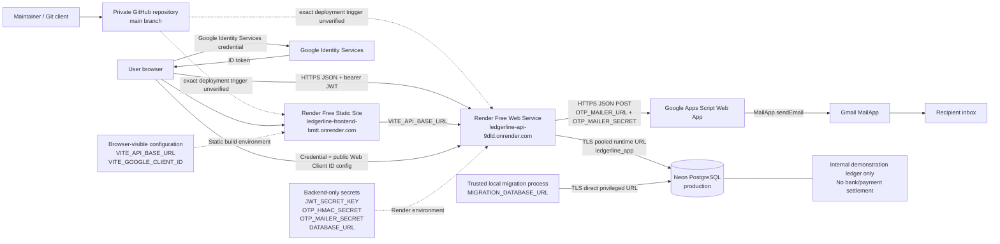

# Deployment architecture

This deployment view separates public browser configuration from backend
secrets. GitHub is the private source repository. The exact Render
auto-deployment trigger is external Dashboard configuration and was not
independently verified.

Editable source: [deployment-architecture.mmd](deployment-architecture.mmd).
