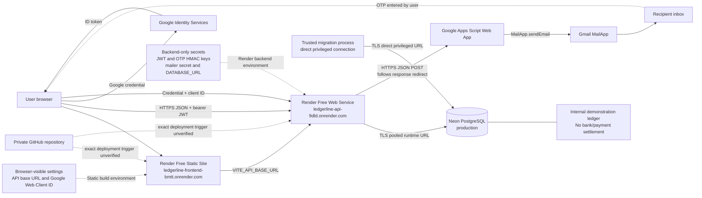

# System architecture

The application is a modular monolith deployed as separate frontend and
backend Render services. The FastAPI backend connects to Neon PostgreSQL over
TLS using a restricted runtime role. Schema changes use a separate privileged
migration connection. Google Identity Services supplies ID-token credentials;
Google Apps Script and Gmail MailApp deliver OTP messages.

The editable [Mermaid source](system-architecture.mmd) is the current
GitHub-rendered view. The existing PNG/SVG are static snapshots generated
before this final consistency pass; Graphviz was unavailable to regenerate
them. The editable Graphviz source is
[system-architecture.dot](system-architecture.dot). The
[deployment architecture Mermaid source](deployment-architecture.mmd) adds
the GitHub source boundary and explicitly notes that the current Render
auto-deployment trigger was not independently verified.

The product boundary is an internal demonstration ledger only. It does not
initiate or settle real payments.