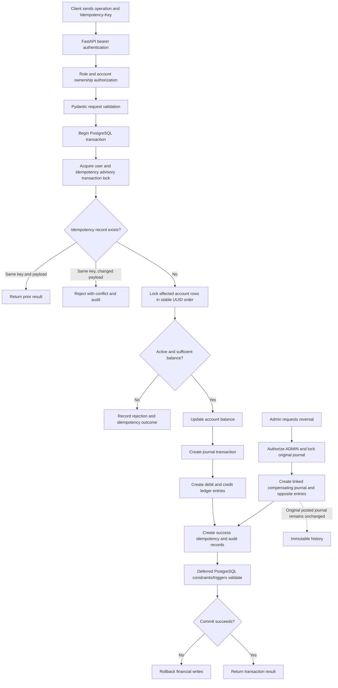

# Transaction lifecycle

This workflow describes the implemented API and PostgreSQL transaction path.
Business rejection and database failure do not produce a partial successful
financial posting. A reversal is a new linked journal entry; the original
posted transaction is not edited.

Editable GitHub Mermaid source: [transaction-flow.mmd](transaction-flow.mmd).